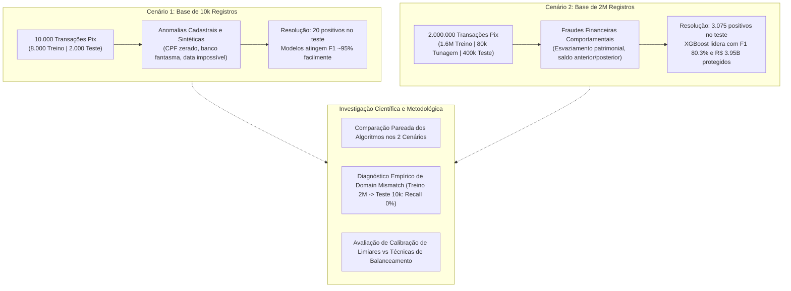
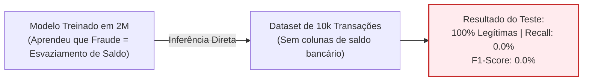

# 🛡️ Detecção de Fraudes e Anomalias em Transações Pix: Estudo Comparativo entre Datasets de 10k e 2M Registros

Projeto acadêmico e experimental de Ciência de Dados e Machine Learning voltado à **investigação, avaliação e comparação do comportamento de algoritmos preditivos (XGBoost, Random Forest e Regressão Logística)** em transações financeiras Pix no Brasil sob dois cenários experimentais de volume, complexidade e natureza de anomalias distintos:

1. **Cenário de 10 mil transações** ([`juniorbueno/pix-banking-transaction`](https://www.kaggle.com/datasets/juniorbueno/pix-banking-transaction)): focado na identificação de anomalias sintéticas de cadastro, formato e integridade sistêmica.
2. **Cenário de 2 milhões de transações** ([`andremessina/pix-fraud-br`](https://huggingface.co/datasets/andremessina/pix-fraud-br)): focado na detecção em larga escala de fraudes financeiras comportamentais (esvaziamento patrimonial e desvios de saldo).

O estudo analisa criticamente as variações de desempenho estatístico, a eficácia de técnicas de balanceamento de classes (`Baseline`, `RandomUnderSampler`, `SMOTE` e `SMOTETomek`), o impacto da calibração de limiares ótimos de decisão (`TunedThresholdClassifierCV`), as barreiras empíricas de generalização cruzada (*Domain Mismatch*) e o impacto financeiro (volume monetário protegido versus falsos positivos).

---

## 📋 Sumário
- [Objetivos da Pesquisa](#-objetivos-da-pesquisa)
- [Caracterização dos Cenários: 10k vs 2M](#-caracterização-dos-cenários-10k-vs-2m)
- [Metodologia Experimental](#-metodologia-experimental)
- [Comparação de Desempenho dos Algoritmos (10k vs 2M)](#-comparação-de-desempenho-dos-algoritmos-10k-vs-2m)
  - [Visão Comparativa Unificada](#visão-comparativa-unificada)
  - [Análise Detalhada por Modelo](#análise-detalhada-por-modelo)
  - [Resolução Estatística e Estabilidade](#resolução-estatística-e-estabilidade)
- [O Fenômeno do Domain Mismatch (Treino 2M e Teste 10k)](#-o-fenômeno-do-domain-mismatch-treino-2m-e-teste-10k)
- [Impacto da Calibração de Limiar e Balanceamento](#-impacto-da-calibração-de-limiar-e-balanceamento)
- [Impacto Financeiro (Volume Salvo em R$)](#-impacto-financeiro-volume-salvo-em-r)
- [Catálogo de Gráficos e Visualizações](#-catálogo-de-gráficos-e-visualizações)
  - [Gráficos do Dataset de 2M](#gráficos-do-dataset-de-2m)
  - [Gráficos do Dataset de 10k](#gráficos-do-dataset-de-10k)
- [Instalação e Configuração](#-instalação-e-configuração)
- [Como Reproduzir os Experimentos](#-como-reproduzir-os-experimentos)
- [Dashboard Interativo Offline](#-dashboard-interativo-offline)
- [Estrutura do Repositório](#-estrutura-do-repositório)
- [Uso do Modelo em Produção](#-uso-do-modelo-em-produção)
- [Autoria e Licença](#-autoria-e-licença)

---

## 🎯 Objetivos da Pesquisa

A proposta central deste projeto é compreender como modelos supervisionados de detecção de fraudes respondem a mudanças na escala dos dados e na formulação do conceito de anomalia:



As perguntas científicas norteadoras foram:
1. **Sensibilidade à Natureza do Rótulo**: Como árvores de decisão e modelos lineares se comportam quando a anomalia é um erro formal de integridade versus um desvio financeiro dinâmico?
2. **Impacto do Volume de Treino**: Um modelo treinado em milhões de exemplos necessariamente supera modelos treinados em bases menores, ou o ganho está condicionado à pertinência dos atributos?
3. **Transferibilidade de Domínio**: Um modelo industrial calibrado em milhões de transações generaliza para um ambiente de dados cadastrais heterogêneo?
4. **Viabilidade Econômica**: Qual é a relação entre taxa de falso alarme, cobertura de fraude e capital financeiro protegido em cada contexto?

---

## 🔍 Caracterização dos Cenários: 10k vs 2M

Os dois experimentos utilizam bases com hipóteses de geração, campos e prevalências substancialmente distintas. Trata-se de **dois cenários experimentais complementares**, e não de mera extensão de linhas da mesma tabela:

| Dimensão de Análise | Dataset de 10 mil transações | Dataset de 2 milhões de transações |
| :--- | :--- | :--- |
| **Origem e Repositório** | Kaggle ([`juniorbueno/pix-banking-transaction`](https://www.kaggle.com/datasets/juniorbueno/pix-banking-transaction)) | Hugging Face ([`andremessina/pix-fraud-br`](https://huggingface.co/datasets/andremessina/pix-fraud-br)) |
| **Volume Total de Registros** | 10.000 transações | 2.000.000 transações |
| **Divisão Experimental** | 8.000 treino (80%) / 2.000 teste (20%) | 1.600.000 treino (80%) / 400.000 teste (20%) + 80k tunagem |
| **Casos Positivos Totais** | 100 anomalias (1,00% da base) | 15.376 fraudes (0,769% da base) |
| **Positivos no Conjunto de Teste** | 20 anomalias | 3.075 fraudes |
| **Conceito da Classe Positiva** | **Anomalias de Cadastro e Integridade**: erros sintéticos de data/hora (`2025-02-30`), valor zerado (`R$ 0,00`), banco fantasma, CPFs inconsistentes e titularidade divergente. | **Fraudes Comportamentais de Esvaziamento**: movimentações financeiras atípicas com esvaziamento total ou desproporcional de saldos residuais em contas de origem. |
| **Atributos Disponíveis** | Identificadores cadastrais, banco remetente/destinatário, chaves Pix, timestamps, valores monetários (sem saldos bancários). | Saldos antes e depois da transação (pagador e recebedor), timestamps, tipo de transferência, razão de saldo residual, limites noturnos. |
| **Escala dos Valores Monetários** | Valores entre R$ 0,01 e R$ 4.999,00 (média ~ R$ 2.500,00). | Valores de fraude com média de R$ 1.460.000,00 (esvaziamento de grandes saldos). |
| **Resolução Estatística do Teste** | **5,00% por ocorrência** (cada fraude acertada ou errada altera o Recall em 5 p.p.). | **~0,0325% por ocorrência** (alta precisão e estabilidade estatística das métricas). |

---

## 🔬 Metodologia Experimental

Para garantir reprodutibilidade e evitar vazamento de dados (*data leakage*), ambos os experimentos adotaram protocolos rigorosos:

1. **Separação Estratificada Estrita**: As divisões de treino e teste mantiveram a taxa exata da classe minoritária. O conjunto de teste independente (2.000 no 10k; 400.000 no 2M) permaneceu intocado durante as fases de ajuste e seleção de modelos.
2. **Validação Cruzada Interna e Externa**:
   - Para a base de 10k: 5 folds externos para avaliação de desempenho pareado e 5 folds internos para calibração de limiares.
   - Para a base de 2M: amostra estratificada de 80.000 transações (60k sub-treino / 20k sub-validação) para tunagem ágil de 18 combinações de hiperparâmetros, seguido do retreinamento completo em 1.600.000 exemplos.
3. **Pré-processamento Isolado por Fold**: Codificação de categóricas (`OneHotEncoder`), imputação (`SimpleImputer`) e padronização (`StandardScaler` para a Regressão Logística) ajustados estritamente nas amostras de treino de cada divisão.
4. **Técnicas de Balanceamento Avaliadas**:
   - `Baseline`: pesos de classe balanceados (`scale_pos_weight` no XGBoost; `class_weight="balanced"` no Random Forest e Regressão Logística).
   - `RandomUnderSampler`: subamostragem aleatória da classe majoritária.
   - `SMOTE`: superamostragem sintética da classe minoritária por interpolação de vizinhos próximos.
   - `SMOTETomek`: superamostragem com limpeza de fronteiras por pares de Tomek.
5. **Calibração de Limiar de Decisão**: Substituição do corte arbitrário `0.50` pela busca do limiar ótimo de probabilidade para maximização do F1-Score via `TunedThresholdClassifierCV`.

---

## 📊 Comparação de Desempenho dos Algoritmos (10k vs 2M)

### Visão Comparativa Unificada

Abaixo estão os resultados consolidados obtidos pelas melhores configurações selecionadas de cada família algorítmica em seus respectivos conjuntos de teste independentes:

| Algoritmo | Base Avaliada | Estratégia Selecionada | Acurácia | Precisão | Recall | F1-Score | ROC-AUC | AP (PR-AUC) | Limiar Ótimo |
| :--- | :--- | :--- | :---: | :---: | :---: | :---: | :---: | :---: | :---: |
| **XGBoost** 🏆 | **10 mil** | SMOTE | 99,90% | 95,00% | 95,00% | **95,00%** | 95,68% | 94,54% | `0.2827` |
| **XGBoost** 🏆 | **2 milhões** | Baseline | 99,70% | 81,06% | 79,61% | **80,33%** | 99,76% | **88,41%** | `0.6264` |
| **Random Forest** | **10 mil** | Baseline | 99,95% | 95,00% | 95,00% | **95,00%** | 95,19% | 95,05% | `0.3675` |
| **Random Forest** | **2 milhões** | Baseline | 99,62% | 80,83% | 66,24% | **72,82%** | 99,73% | 83,99% | `0.9697` |
| **Regressão Logística** | **10 mil** | Under-sampling | 99,30% | 100,00% | 40,00% | **57,14%** | 89,40% | 51,19% | `0.7273` |
| **Regressão Logística** | **2 milhões** | SMOTE | 99,46% | 64,41% | 65,92% | **65,16%** | 99,37% | 66,05% | `0.9697` |

> [!NOTE]
> No código, a métrica de precisão média sob a curva é computada via `average_precision_score` (Average Precision - AP). Por convenção metodológica, ela é reportada como **AP (PR-AUC)** para distingui-la de integrações trapezoidais simples.

---

### Análise Detalhada por Modelo

#### 1. XGBoost (Gradient Boosted Trees)
- **No cenário de 10k**: O modelo atinge 95,00% de F1 com apenas 1 falso positivo e 1 falso negativo em 20 anomalias. Ele aprende com facilidade as regras determinísticas sintéticas embutidas nos dados cadastrais.
- **No cenário de 2M**: Lidera com folga o desempenho geral, alcançando **80,33% de F1-Score** e **88,41% de AP**, com o melhor equilíbrio entre detecção (79,61% de Recall) e controle de falsos alertas (81,06% de Precisão). O algoritmo constrói árvores profundas e combinadas capazes de capturar interações não lineares entre saldo residual, proporção enviada e horário noturno.
- **Ponto de Atenção Crítico**: No teste de 2M, ainda deixa passar **627 fraudes (20,39% dos positivos)** e gera 572 falsos positivos (18,94% de todos os alertas emitidos).

#### 2. Random Forest (Ensemble Bagging)
- **No cenário de 10k**: Empata com o XGBoost em F1 (95,00%), atingindo até 97,44% em configurações com SMOTE/Under-sampling no teste.
- **No cenário de 2M**: Sofre uma perda acentuada de Recall (**66,24%**, F1 de 72,82%), deixando escapar **1.038 fraudes (33,76% das fraudes totais)**. Embora gere ligeiramente menos falsos alarmes (483 alertas incorretos), o custo de oportunidade de quase 1.040 fraudes não detectadas inviabiliza sua escolha como modelo primário de segurança.
- **Ponto de Atenção**: O limiar extremo necessário (`0.9697`) comprime as predições e restringe sua flexibilidade em produção.

#### 3. Regressão Logística (Linear Classifier com Scaler)
- **No cenário de 10k**: Atinge 100% de precisão ao classificar 8 anomalias sem gerar falsos positivos, mas falha em detectar 12 das 20 anomalias (Recall de 40,00%, F1 de 57,14%).
- **No cenário de 2M**: O Recall sobe para 65,92% com auxílio do SMOTE, mas a precisão despenca para 64,41%, resultando em **1.120 falsos alarmes** (mais que o dobro do XGBoost). A incapacidade intrínseca de modelar fronteiras de decisão curvilíneas e interações complexas de saldo limita severamente a Regressão Logística em problemas financeiros multidimensionais.

---

### Resolução Estatística e Estabilidade

Um dos achados centrais da comparação é a discrepância de resolução estatística entre as duas bases:
- No teste de **10 mil registros** (20 anomalias no teste), cada amostra positiva representa **5,0 pontos percentuais** no Recall. Portanto, a diferença entre 90% e 95% de recall corresponde à classificação de **uma única transação**.
- No teste de **2 milhões de registros** (3.075 fraudes no teste), cada amostra positiva representa aproximadamente **0,0325 ponto percentual** no Recall. As métricas refletem com muito maior fidelidade o comportamento populacional contínuo do algoritmo.

---

## 🚫 O Fenômeno do Domain Mismatch (Treino 2M e Teste 10k)

Durante o desenvolvimento, realizamos um teste empírico de transferência de domínio: **treinar os modelos no dataset de 2M e validá-los diretamente sobre as 10.000 transações do dataset menor**.

O resultado prático foi contraintuitivo e revelador:
- **O modelo de 2M classificou 100% das 10.000 transações como legítimas!**
- **Acurácia aparente: 99,00%** (exatamente a proporção de legítimas).
- **Recall: 0,00%** e **F1-Score: 0,00%** (nenhuma das 100 anomalias foi detectada).



### Diagnóstico Técnico das Causas-Raiz:

1. **Dependência Massiva de Variáveis de Saldo (89,1% da Importância)**:
   A análise de ganho de informação (*Feature Importance*) do XGBoost treinado no 2M revela que a tomada de decisão depende quase que exclusivamente de balanços de conta:
   - `proporcao_valor_recebedor`: **31,1%**
   - `saldo_anterior_recebedor`: **29,6%**
   - `razao_saldo_residual`: **12,1%**
   - `saldo_posterior_pagador`: **7,1%**
   - `saldo_posterior_recebedor`: **5,3%**
   - `saldo_anterior_pagador`: **3,9%**
   - **Total das variáveis de saldo bancário: 89,1% de toda a inteligência do modelo.**
   Como o dataset de 10k **não possui campos de saldo bancário**, todas as variáveis foram imputadas com os valores medianos de normalidade, fazendo o modelo inferir que todas as contas estavam em perfeita saúde financeira.

2. **Divergência de Ordens de Grandeza**:
   No dataset de 2M, as fraudes são movimentações de valores expressivos (média de R$ 1,46 milhão). No dataset de 10k, o valor máximo registrado é de R$ 4.999,00. Para um classificador treinado no 2M, uma transação de R$ 2.000,00 com saldo saudável tem probabilidade predita de fraude inferior a **0,69%**.

3. **Incompatibilidade Conceitual (*Concept Drift* / Domínios Disjuntos)**:
   - A base de 10k modela **anomalias formais de sistema/cadastro** (erros ortográficos, CPFs zerados, datas inexistentes).
   - A base de 2M modela **fraudes financeiras patrimoniais**.
   - **Conclusão Metodológica**: Modelos de aprendizado de máquina não transferem conhecimento entre espaços conceituais que não compartilham a mesma semântica de atributos.

---

## ⚖️ Impacto da Calibração de Limiar e Balanceamento

Em cenários com forte desbalanceamento de classes (~0,77% a 1,00% de positivos), o limiar padrão de `0.50` prejudica severamente o F1-Score:

```text
Evolução do F1-Score com a Calibração de Limiar (Base 2M - XGBoost):
Limiar Padrão (0.50)  ───► F1: ~71.4%
Limiar Calibrado (0.6264) ─► F1: 80.33% (+8.93 p.p. de melhoria direta)
```

- **Amostragem Artificial vs Ajuste de Pesos**: Na base de 2M, técnicas como SMOTE exigem elevado custo computacional e dilatam a fronteira de decisão com dados sintéticos lineares. O ajuste de pesos de perda (`scale_pos_weight`) combinado à calibração de limiar (`TunedThresholdClassifierCV`) superou o SMOTE em precisão e velocidade de convergência.
- **Na base de 10k**: Pelo reduzido número de exemplos (apenas 80 anomalias no treino), o SMOTE e o Under-sampling tiveram impacto relevante ao forçar o separador a não ignorar a classe minoritária.

---

## 💰 Impacto Financeiro (Volume Salvo em R$)

Em sistemas de prevenção a fraudes, métricas percentuais devem ser traduzidas em impacto monetário no balanço patrimonial:

### Cenário 2M (Teste Independente de 400.000 Transações)
No conjunto de teste, as 3.075 fraudes representaram um volume criminoso total de **R$ 4.405.302.309,06** (R$ 4,40 bilhões):

| Modelo | Fraudes Bloqueadas (R$) | % do Volume Protegido | Perda Residual (Fraudes Não Detectadas) | Falsos Alarmes (Volume Bloqueado Indevidamente) |
| :--- | :---: | :---: | :---: | :---: |
| **XGBoost (Baseline)** 🏆 | **R$ 3.955.017.221,14** | **89,78%** | **R$ 450.285.087,92 (10,22%)** | **R$ 452.574.394,53** (572 alertas incorretos) |
| **Random Forest (Baseline)** | R$ 3.491.331.310,22 | 79,25% | R$ 913.970.998,84 (20,75%) | R$ 302.326.552,11 (483 alertas incorretos) |
| **Regressão Logística (SMOTE)** | R$ 3.939.029.492,25 | 89,42% | R$ 466.272.816,81 (10,58%) | R$ 3.093.074.383,39 (1.120 alertas incorretos) |

> [!IMPORTANT]
> O **XGBoost interceptou quase R$ 4 bilhões em fraudes**, garantindo proteção a **89,78% do volume financeiro atacado**, gerando falsos alarmes em apenas **0,14%** das transações legítimas. A Regressão Logística, embora proteja volume similar, bloqueia mais de **R$ 3 bilhões em transações legítimas de clientes idôneos**, gerando atrito operacional inaceitável.

### Cenário 10k (Teste Independente de 2.000 Transações)
Na base de 10k, os valores monetários representam anomalias cadastrais pontuais:
- **XGBoost e Random Forest**: Interceptam **R$ 37.148,66** em transações anômalas, deixando uma perda residual de **R$ 4.423,06**.
- **Regressão Logística**: Intercepta apenas **R$ 20.812,26**, permitindo que **R$ 20.759,46** em anomalias passem despercebidos.

---

## 📈 Catálogo de Gráficos e Visualizações

Todos os gráficos são exportados em alta resolução para documentação e análise comparativa:

### Gráficos do Dataset de 2M
Diretório: [`src/notebooks/graficos/`](src/notebooks/graficos/)

| Arquivo | Descrição |
| :--- | :--- |
| [`01_comparacao_por_modelo-2m.png`](src/notebooks/graficos/01_comparacao_por_modelo-2m.png) | Boxplots com a distribuição das métricas (PR-AUC, F1 Tunado, ROC-AUC) entre as três famílias no 2M. |
| [`02_impacto_por_tunagem.png`](src/notebooks/graficos/02_impacto_por_tunagem.png) | Comparação direta entre o Limiar Padrão (0.50) e o Limiar Calibrado, evidenciando o ganho de F1. |
| [`03_tunagem_por_balanceamento.png`](src/notebooks/graficos/03_tunagem_por_balanceamento.png) | Desempenho cruzado entre técnicas de amostragem (`Baseline`, `Under-sampling`, `SMOTE`). |
| [`04_matrizes_confusao_teste_2m.png`](src/notebooks/graficos/04_matrizes_confusao_teste_2m.png) | Matrizes de confusão reais no teste independente de 400.000 transações para os 3 modelos. |
| [`05_curvas_roc_teste_2m.png`](src/notebooks/graficos/05_curvas_roc_teste_2m.png) | Curvas ROC comparativas (XGBoost alcançando 99,76% de ROC-AUC). |
| [`06_curvas_precision_recall_teste_2m.png`](src/notebooks/graficos/06_curvas_precision_recall_teste_2m.png) | Curvas Precision-Recall comparativas contra a linha de base aleatória de 0,77%. |
| [`07_tradeoff_limiar_metricas_teste_2m.png`](src/notebooks/graficos/07_tradeoff_limiar_metricas_teste_2m.png) | Curvas contínuas de trade-off de Precisão, Recall e F1, destacando o ponto ótimo `0.6264`. |
| [`08_distribuicao_probabilidades_teste_2m.png`](src/notebooks/graficos/08_distribuicao_probabilidades_teste_2m.png) | Estimativa de densidade de probabilidade (KDE) demonstrando separação entre classes. |
| [`09_impacto_financeiro_teste_2m.png`](src/notebooks/graficos/09_impacto_financeiro_teste_2m.png) | Comparativo de volume monetário: Fraudes Bloqueadas (R$ 3,95B) vs Perda Residual. |

### Gráficos do Dataset de 10k
Diretório: [`src/notebooks/graficos/10k/`](src/notebooks/graficos/10k/) e [`resultados/10k/`](resultados/10k/)

| Arquivo | Descrição |
| :--- | :--- |
| [`visao_geral.png`](resultados/10k/visao_geral.png) | Painel integrado com visão geral de métricas, matrizes e curvas da base de 10k. |
| [`01_comparacao_por_modelo-10k (1).png`](src/notebooks/graficos/10k/01_comparacao_por_modelo-10k%20%281%29.png) | Distribuição das métricas de validação cruzada entre os modelos na base de 10k. |
| [`02_impacto_por_tunagem.png`](src/notebooks/graficos/10k/02_impacto_por_tunagem.png) | Efeito da calibração de limiares nos folds externos do experimento de 10k. |
| [`03_tunagem_por_balanceamento.png`](src/notebooks/graficos/10k/03_tunagem_por_balanceamento.png) | Comparação de amostragem (`Baseline`, `SMOTE`, `Under-sampling`, `SMOTETomek`) no 10k. |
| [`05_curvas_roc_teste_10k.png`](src/notebooks/graficos/10k/05_curvas_roc_teste_10k.png) | Curvas ROC comparativas no teste de 2.000 transações. |
| [`06_curvas_precision_recall_teste_10k.png`](src/notebooks/graficos/10k/06_curvas_precision_recall_teste_10k.png) | Curvas Precision-Recall comparativas para as 12 variantes testadas. |
| [`07_tradeoff_limiar_metricas_teste_10k.png`](src/notebooks/graficos/10k/07_tradeoff_limiar_metricas_teste_10k.png) | Trade-off descritivo de limiares no teste de 10k. |
| [`08_distribuicao_probabilidades_teste_10k.png`](src/notebooks/graficos/10k/08_distribuicao_probabilidades_teste_10k.png) | Distribuição das probabilidades preditas no teste de 10k. |
| [`09_impacto_financeiro_teste_10k.png`](src/notebooks/graficos/10k/09_impacto_financeiro_teste_10k.png) | Volume financeiro sinalizado vs anomalias perdidas no cenário de 10k. |

---

## 🚀 Instalação e Configuração

### Pré-requisitos
- **Python 3.10 ou superior**.
- Git instalado.

### Clone do Repositório
```bash
git clone https://github.com/<seu-usuario>/final_project.git
cd final_project
```

### Configuração do Ambiente Virtual (`venv`)

#### Linux e macOS
```bash
python3 -m venv .venv
source .venv/bin/activate
pip install --upgrade pip
pip install -r requirements.txt
```

#### Windows (PowerShell)
```powershell
python -m venv .venv
Set-ExecutionPolicy -ExecutionPolicy RemoteSigned -Scope CurrentUser
.\.venv\Scripts\Activate.ps1
python -m pip install --upgrade pip
pip install -r requirements.txt
```

---

## ⚡ Como Reproduzir os Experimentos

### 1. Executar o Experimento do Dataset de 2 Milhões
Executa o download automático do dataset da Hugging Face, engenharia de atributos, tunagem de 18 configurações na amostra de 80k, geração dos 9 gráficos do 2M, retreinamento em 1.6M e teste final em 400k:
```bash
python main.py
```
*(Tempo médio de execução: 1 a 2 minutos em CPUs modernas).*

### 2. Executar o Experimento do Dataset de 10 Mil
Executa o pipeline estratificado de 10k (8.000 treino / 2.000 teste), calibra limiares pareados em 12 configurações e gera os 9 gráficos em `src/notebooks/graficos/10k/`:
```bash
python plot_pix_10k.py
```
*Para reutilizar resultados previamente salvos sem reprocessar:*
```bash
python plot_pix_10k.py --saved
```

### 3. Executar a Avaliação Sistemática de Modelos no 10k
Executa os 24 experimentos da base de 10k com validação cruzada completa e gera as tabelas em `resultados/tabelas/`:
```bash
python evaluate_models.py
```

### 4. Validação Automatizada de Consistência
Verifica se todas as tabelas, métricas recalculadas, matrizes e imagens estão íntegras e sem inconsistências:
```bash
python verify_results.py
```

---

## 🖥️ Dashboard Interativo Offline

O repositório possui uma interface analítica interativa para inspeção visual dos resultados sem necessidade de servidores externos ou banco de dados:

1. Gere o dashboard a partir dos artefatos:
   ```bash
   python build_dashboard.py
   ```
2. Abra o arquivo gerado [`resultados/dashboard/index.html`](resultados/dashboard/index.html) em qualquer navegador web moderno:
   ```bash
   # Linux
   xdg-open resultados/dashboard/index.html

   # macOS
   open resultados/dashboard/index.html

   # Windows
   start resultados/dashboard/index.html
   ```

---

## 📁 Estrutura do Repositório

```text
├── main.py                         # Pipeline principal do dataset de 2M (Treino 1.6M, Teste 400k)
├── plot_pix_10k.py                 # Pipeline de geração dos gráficos e tabelas do dataset de 10k
├── evaluate_models.py              # Avaliação exaustiva de validação cruzada (24 configs no 10k)
├── verify_results.py               # Script de verificação de integridade dos artefatos e métricas
├── build_dashboard.py              # Gerador do dashboard offline em HTML
├── requirements.txt                # Dependências e bibliotecas do projeto
├── README.md                       # Documentação técnica e científica do projeto
│
├── src/
│   ├── data/
│   │   ├── ingestion.py            # Ingestão de dados (Hugging Face / PaySim) e funções de amostragem
│   │   └── cleaning.py             # Limpeza, extração de features temporais e balanceamento
│   ├── models/
│   │   ├── xgboost.py              # Pipelines, hiperparâmetros e estimador XGBoost
│   │   ├── random_forest.py        # Pipeline e configurações Random Forest
│   │   └── logistic_regression.py   # Pipeline com StandardScaler para Regressão Logística
│   └── notebooks/
│       ├── df2m.py                 # Análise exploratória original da base de 2M
│       ├── pix.py                  # Análise exploratória original da base de 10k
│       └── graficos/               # Visualizações geradas
│           ├── *.png               # 9 Gráficos em alta resolução do experimento de 2M
│           └── 10k/                # 9 Gráficos em alta resolução do experimento de 10k
│
└── resultados/
    ├── dashboard/
    │   └── index.html              # Dashboard offline consolidado
    ├── modelos/
    │   ├── melhor_modelo_pix.joblib # Modelo XGBoost final serializado (1.6M + Limiar calibrado)
    │   └── melhor_modelo_pix.json   # Metadados e métricas completas do modelo final
    ├── relatorios/
    │   ├── RELATORIO.md            # Relatório metodológico da base de 10k
    │   └── PONTOS_DE_ATENCAO_2M.md # Análise aprofundada dos pontos de atenção da base de 2M
    ├── 10k/                        # Métricas, matrizes e predições do teste de 10k
    └── tabelas/                    # Tabelas de validação cruzada e importância de variáveis
```

---

## 🔌 Uso do Modelo em Produção

O pipeline serializa o artefato completo contendo o pré-processamento (`OneHotEncoder` e `SimpleImputer`), o estimador XGBoost ajustado e o invólucro do limiar calibrado (`0.6264`).

Para carregar o modelo e classificar novas transações Pix em tempo real:

```python
import joblib
import pandas as pd

# 1. Carregar o modelo treinado com limiar calibrado
modelo = joblib.load("resultados/modelos/melhor_modelo_pix.joblib")

# 2. Exemplo de nova transação financeira
nova_transacao = pd.DataFrame([{
    "tipo_transacao": "chave_pix",
    "valor_brl": 1500000.00,
    "saldo_anterior_pagador": 1500000.00,
    "saldo_posterior_pagador": 0.00,        # Alerta: conta totalmente esvaziada!
    "saldo_anterior_recebedor": 500.00,
    "saldo_posterior_recebedor": 1500500.00,
    "dia_util": 1,
    "horario_noturno": 1,                   # Transação realizada em horário noturno
    "acima_limite_noturno": 1,
    "razao_saldo_residual": 0.00,
    "proporcao_valor_recebedor": 1.00,
    "Hora": 23,
    "Dia_Da_Semana": 4,
    "qtd_transacoes_pagador": 5,
    "media_valor_pagador": 1200.00,
    "mediana_valor_pagador": 800.00
}])

# 3. Predição utilizando o limiar ótimo calibrado (0.6264)
predicao = modelo.predict(nova_transacao)
probabilidade = modelo.predict_proba(nova_transacao)[:, 1]

print(f"Decisão do Sistema: {'🚨 BLOQUEAR (SUSPEITA DE FRAUDE)' if predicao[0] == 1 else '✅ APROVAR (TRANSAÇÃO LEGÍTIMA)'}")
print(f"Probabilidade Calculada: {probabilidade[0] * 100:.2f}%")
```

---

## 👥 Autoria e Licença

Trabalho de conclusão e pesquisa acadêmica sobre integridade e prevenção a fraudes no ecossistema de pagamentos instantâneos (Pix) no Brasil.

Distribuído sob a licença **MIT**. Consulte os arquivos de código para termos adicionais de utilização.
