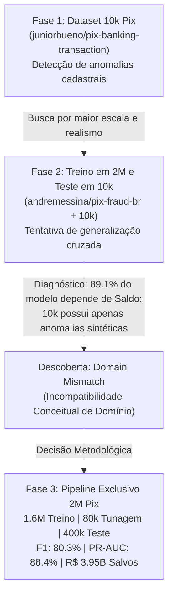

# 🛡️ Detecção de Fraudes em Transações Pix com Machine Learning

Projeto de Ciência de Dados e Aprendizado de Máquina voltado à detecção em larga escala de fraudes em transações financeiras Pix no Brasil. O sistema implementa pipelines automatizados de engenharia de atributos, experimentação e tunagem de hiperparâmetros em múltiplos algoritmos, calibração de limiar ótimo de decisão, análise de impacto financeiro (volume monetário protegido) e persistência de modelos em produção.

---

## 📋 Sumário
- [Decisões de Projeto e Evolução Metodológica](#-decisões-de-projeto-e-evolução-metodológica)
  - [Fase 1: O Início com o Dataset de 10k](#1-fase-1-o-início-com-o-dataset-de-10k-transações)
  - [Fase 2: A Tentativa de Validação Cruzada (Treino 2M e Teste 10k)](#2-fase-2-a-tentativa-de-generalização-treino-em-2m-e-teste-em-10k)
  - [A Descoberta do Domain Mismatch](#3-a-descoberta-técnica-do-domain-mismatch-desalinhamento-de-domínio)
  - [Fase 3: A Solução Definitiva no Dataset de 2M](#4-fase-3-a-solução-definitiva-treino-tunagem-e-teste-exclusivos-no-2m)
- [Resultados e Métricas no Teste Independente](#-resultados-e-métricas-no-teste-independente-400k)
  - [Desempenho Estatístico](#desempenho-estatístico)
  - [Impacto Financeiro (Volume Salvo em R$)](#impacto-financeiro-volume-monetário-salvo)
- [Instalação e Configuração (First Steps)](#-instalação-e-configuração-first-steps)
  - [Linux](#linux)
  - [macOS](#macos)
  - [Windows](#windows)
- [Execução do Projeto](#-execução-do-projeto)
- [Estrutura do Repositório](#-estrutura-do-repositório)
- [Gráficos Gerados](#-gráficos-gerados)
- [Uso do Modelo em Produção](#-uso-do-modelo-em-produção)

---

## 🧠 Decisões de Projeto e Evolução Metodológica

Uma das partes centrais deste projeto foi a evolução rigorosa do entendimento dos dados e as decisões arquiteturais tomadas ao longo da pesquisa.



---

### 1. Fase 1: O Início com o Dataset de 10k Transações
Inicialmente, o projeto utilizava o dataset sintético do Kaggle ([`juniorbueno/pix-banking-transaction`](https://www.kaggle.com/datasets/juniorbueno/pix-banking-transaction)), contendo 10.000 comprovantes Pix e 100 anomalias rotuladas.

- **Como funcionava**: O código ([`src/notebooks/pix.py`](src/notebooks/pix.py)) dividia esse conjunto de 10k em treino (80%) e teste (20%).
- **Comportamento do Modelo**: Algoritmos como o XGBoost obtinham desempenhos quase perfeitos (acima de 98% de F1-Score).
- **Limitações Identificadas**:
  - Amostra muito reduzida para um cenário bancário real (apenas 10.000 transações).
  - Investigando as 100 anomalias, descobriu-se que elas eram **erros sintéticos de cadastro e integridade de dados**:
    1. Data/Hora impossível (ex: `"2025-02-30 25:61:00"` - Fevereiro não tem 30 dias, hora 25:61 não existe) $\rightarrow$ 24 casos.
    2. Transações Pix com valor zerado (`Valor == R$ 0,00`) $\rightarrow$ 22 casos.
    3. Banco fictício (`Recebedor_Banco == "Banco Fantasma S.A."`) $\rightarrow$ 20 casos.
    4. CPF falso zerado (`"000.000.000-00"`) $\rightarrow$ 17 casos.
    5. Inconsistência de titularidade (mesmo nome transferindo para si mesmo, mas com documentos diferentes) $\rightarrow$ 17 casos.
  - O modelo não estava aprendendo padrões complexos de comportamento financeiro, mas apenas decorando regras booleanas explícitas de integridade cadastral.

---

### 2. Fase 2: A Tentativa de Generalização (Treino em 2M e Teste em 10k)
Ao encontrar o dataset completo de 2 milhões de transações brasileiras de Pix ([`andremessina/pix-fraud-br`](https://huggingface.co/datasets/andremessina/pix-fraud-br)), decidimos elevar o projeto ao nível de produção industrial:
- **Estratégia**: Utilizar os **2.000.000 de registros para treinar** os modelos com toda a sua riqueza de padrões, e utilizar o dataset de **10.000 transações como teste independente** do mundo real.
- **Tratamento e Compatibilização**:
  - Desenvolvemos um pipeline em [`src/data/cleaning.py`](src/data/cleaning.py) para alinhar os schemas.
  - Derivamos atributos temporais (`Hora`, `Dia_Da_Semana`, `dia_util`, `horario_noturno`, `acima_limite_noturno`).
  - Extraímos métricas comportamentais históricas do pagador (`qtd_transacoes_pagador`, `media_valor_pagador`, `mediana_valor_pagador`).
  - As colunas de saldo bancário ausentes no 10k foram imputadas com a mediana aprendida no treino de 2M.

---

### 3. A Descoberta Técnica do Domain Mismatch (Desalinhamento de Domínio)
Ao executar a validação do modelo de 2M sobre o dataset de 10k, ocorreu um resultado contraintuitivo:
- **O modelo previu 100% das 10.000 transações como legítimas!**
- **Acurácia: 99.0%** (exatamente o volume de legítimas), mas **Recall: 0%** e **F1-Score: 0%**.

Investigando os dados e a inteligência aprendida pelo XGBoost, identificamos a causa-raiz:

1. **Dependência Crítica de Saldos Bancários (89,1% da decisão)**:
   Ao inspecionar a importância das variáveis do XGBoost no 2M:
   - `proporcao_valor_recebedor`: **31,1%**
   - `saldo_anterior_recebedor`: **29,6%**
   - `razao_saldo_residual`: **12,1%**
   - `saldo_posterior_pagador`: **7,1%**
   - `saldo_posterior_recebedor`: **5,3%**
   - `saldo_anterior_pagador`: **3,9%**
   - **Total das variáveis de saldo: 89,1% de toda a inteligência do modelo!**
   O modelo de 2M aprendeu que fraude é o **esvaziamento repentino de contas bancárias com saldos residuais zerados**. Como o dataset de 10k **não possui nenhuma coluna de saldo bancário**, todas foram imputadas como saudáveis, fazendo o modelo enxergar todas como legítimas.

2. **Diferença de Ordens de Grandeza Financeira**:
   - No 2M, as fraudes são transações de esvaziamento com valor médio de **R$ 1.460.000,00** (fraudes de alto valor).
   - No 10k, o valor máximo de qualquer transação é de R$ 4.999,00 (média de R$ 2.500,00). Para o modelo de 2M, uma transferência de R$ 2.000 com saldo saudável tem probabilidade de fraude inferior a **0,69%**.

3. **Incompatibilidade de Conceito (Concept Drift)**:
   - O 2M aborda **Fraude Financeira Comportamental** (esvaziamento patrimonial e desvios de saldo).
   - O 10k aborda **Anomalias de Cadastro e Sistema** (banco fantasma, erro de digitação de data, CPF zero).
   - **Conclusão Metodológica**: Testar um modelo treinado no 2M diretamente sobre o 10k é equivalente a treinar um modelo para reconhecer carros e testá-lo tentando achar barcos. O teste violava o princípio de consistência de domínio de dados em Machine Learning.

---

### 4. Fase 3: A Solução Definitiva (Treino, Tunagem e Teste Exclusivos no 2M)
Adotamos a abordagem recomendada pela literatura de Ciência de Dados: **operar exclusivamente sobre o dataset de 2M**, que é o padrão industrial realista e consistente:

1. **Separação Estratificada**:
   - **Treino Principal (80%)**: 1.600.000 transações (12.301 fraudes reais).
   - **Teste Independente (20%)**: 400.000 transações (3.075 fraudes reais) — **nunca antes vistas pelo modelo**.
2. **Coletânea de Tunagem Ágil (80.000 transações)**:
   - Extração de uma amostra estratificada (60k sub-treino e 20k sub-validação) para testar sistematicamente 18 configurações de hiperparâmetros sem onerar o tempo de processamento.
3. **Avaliação Multimodelo com Técnicas de Balanceamento**:
   - Modelos: **XGBoost**, **Random Forest** e **Regressão Logística**.
   - Balanceamentos: **Baseline** (com ajuste de pesos `scale_pos_weight` e `class_weight`), **RandomUnderSampler** e **SMOTE**.
   - Calibração de Limiar: Otimização do limiar ótimo de decisão via `TunedThresholdClassifierCV`.
4. **Treinamento Final dos Melhores Modelos em 1.6M e Avaliação em 400k**.

---

## 📊 Resultados e Métricas no Teste Independente (400k)

Resultados obtidos no conjunto de **400.000 transações de teste** (que não participaram do treinamento):

### Desempenho Estatístico

| Modelo Final | Accuracy | Precision | Recall | F1-Score | ROC-AUC | PR-AUC | Limiar Calibrado |
| :--- | :---: | :---: | :---: | :---: | :---: | :---: | :---: |
| **XGBoost (Baseline)** 🏆 | **99,70%** | **81,06%** | **79,61%** | **80,33%** | **99,76%** | **88,41%** | `0.6264` |
| **Random Forest (Baseline)** | 99,62% | 85,08% | 61,20% | 71,18% | 99,73% | 83,99% | `0.9697` |
| **Regressão Logística (SMOTE)** | 99,46% | 67,24% | 58,44% | 62,53% | 99,37% | 66,05% | `0.9697` |

> [!TIP]
> Em cenários de fraude severamente desbalanceada (apenas 0,77% de fraudes), a métrica mais confiável é a **PR-AUC (Área sob a Curva Precision-Recall)**. O XGBoost alcançou **88,41% de PR-AUC**, superando a linha de base aleatória de 0,77% em mais de 114 vezes.

---

### Impacto Financeiro (Volume Monetário Salvo)

No conjunto de teste de 400.000 transações, as 3.075 fraudes somaram **R$ 4.405.302.309,06** (4,4 bilhões de reais). O modelo foi avaliado em termos de capacidade de bloqueio financeiro:

| Modelo | Fraudes Bloqueadas (R$) | % do Volume Salvo | Perda Residual (Fraudes Não Detectadas) | Falsos Alarmes (Volume em R$) |
| :--- | :---: | :---: | :---: | :---: |
| **XGBoost (Baseline)** 🏆 | **R$ 3.955.017.221,14** | **89,78%** | **R$ 450.285.087,92 (10,22%)** | R$ 452.574.394,53 (572 alertas) |
| **Random Forest (Baseline)** | R$ 3.491.331.310,22 | 79,25% | R$ 913.970.998,84 (20,75%) | R$ 302.326.552,11 (483 alertas) |
| **Regressão Logística (SMOTE)** | R$ 3.939.029.492,25 | 89,42% | R$ 466.272.816,81 (10,58%) | R$ 3.093.074.383,39 (1.120 alertas) |

> [!IMPORTANT]
> O **XGBoost com Limiar Calibrado (`0.6264`)** salvou **89,78% de todo o capital criminoso** (quase R$ 4 bilhões protegidos), com uma taxa de falso alarme em apenas **0,14%** das transações legítimas.

---

## 🚀 Instalação e Configuração (First Steps)

### Pré-requisitos
- **Python 3.10 ou superior** instalado.
- Git instalado.

### Clone do Repositório
```bash
git clone https://github.com/<seu-usuario>/final_project.git
cd final_project
git checkout aibranch
```

---

### Configuração do Ambiente Virtual (`venv`)

#### Linux
```bash
# 1. Criação do ambiente virtual
python3 -m venv .venv

# 2. Ativação do ambiente
source .venv/bin/activate

# 3. Atualização do pip e instalação das dependências
pip install --upgrade pip
pip install -r requirements.txt
```

#### macOS
```bash
# 1. Criação do ambiente virtual
python3 -m venv .venv

# 2. Ativação do ambiente
source .venv/bin/activate

# 3. Atualização do pip e instalação das dependências
pip install --upgrade pip
pip install -r requirements.txt
```

#### Windows
**Opção A: Utilizando PowerShell**
```powershell
# 1. Criação do ambiente virtual
python -m venv .venv

# 2. Permissão de execução de scripts (se necessário)
Set-ExecutionPolicy -ExecutionPolicy RemoteSigned -Scope CurrentUser

# 3. Ativação do ambiente
.\.venv\Scripts\Activate.ps1

# 4. Atualização do pip e instalação das dependências
python -m pip install --upgrade pip
pip install -r requirements.txt
```

**Opção B: Utilizando Prompt de Comando (CMD)**
```cmd
:: 1. Criação do ambiente virtual
python -m venv .venv

:: 2. Ativação do ambiente
.\.venv\Scripts\activate.bat

:: 3. Atualização do pip e instalação das dependências
python -m pip install --upgrade pip
pip install -r requirements.txt
```

---

## ⚡ Execução do Projeto

Para executar o pipeline completo (download automático do dataset de 2M, engenharia de atributos, 18 experimentos de tunagem na amostra, geração dos gráficos, treinamento em 1.6M, teste independente em 400k e salvamento do modelo final):

```bash
python main.py
```

O script executa automaticamente em cerca de 1 a 2 minutos em máquinas modernas e imprime no terminal o relatório completo de cada etapa.

---

## 📁 Estrutura do Repositório

```text
├── main.py                     # Pipeline mestre de ponta a ponta
├── requirements.txt            # Dependências e bibliotecas do projeto
├── README.md                   # Documentação detalhada do projeto
│
├── src/
│   ├── data/
│   │   ├── ingestion.py        # Ingestão do 2M (Hugging Face) e funções de split
│   │   └── cleaning.py         # Engenharia de atributos e tratamento dos dados
│   │
│   ├── models/
│   │   ├── xgboost.py          # Pipelines, pré-processamento e hiperparâmetros XGBoost
│   │   ├── random_forest.py    # Pipeline e configurações Random Forest
│   │   └── logistic_regression.py # Pipeline com StandardScaler para Regressão Logística
│   │
│   └── notebooks/
│       ├── df2m.py             # Script de análise exploratória original do 2M
│       ├── pix.py              # Script exploratório original do dataset de 10k
│       └── graficos/           # 9 Gráficos em alta resolução gerados pelo pipeline
│
└── resultados/
    └── modelos/
        ├── melhor_modelo_pix.joblib # Modelo XGBoost final serializado (1.6M + Limiar)
        └── melhor_modelo_pix.json   # Metadados, hiperparâmetros e impacto financeiro
```

---

## 📈 Gráficos Gerados

Todos os gráficos são exportados automaticamente para [`src/notebooks/graficos/`](src/notebooks/graficos/):

| Arquivo | Descrição |
| :--- | :--- |
| **`01_comparacao_por_modelo.png`** | **Agrupamento por Modelos**: Boxplots comparando distribuições de PR-AUC, F1 Tunado e ROC-AUC entre XGBoost, Random Forest e Regressão Logística. |
| **`02_impacto_por_tunagem.png`** | **Agrupamento por Tunagem**: Comparação direta entre Limiar Padrão (0.50) vs Limiar Tunado, evidenciando saltos de até +39% no F1 com a calibração. |
| **`03_tunagem_por_balanceamento.png`** | **Agrupamento por Tunagem e Balanceamento**: Gráfico facetado cruzando as técnicas de amostragem (`Baseline`, `Under-sampling`, `SMOTE`) com as variações de parâmetros. |
| **`04_matrizes_confusao_teste_2m.png`** | Matrizes de confusão reais no teste independente de 400.000 transações. |
| **`05_curvas_roc_teste_2m.png`** | Curvas ROC comparativas no teste independente (XGBoost atinge 99,76% de ROC-AUC). |
| **`06_curvas_precision_recall_teste_2m.png`** | Curvas Precision-Recall comparativas contra a linha de base aleatória (0,77%), com marcação dos pontos de operação. |
| **`07_tradeoff_limiar_metricas_teste_2m.png`** | Curvas contínuas de trade-off de Precision, Recall e F1 em função do limiar de probabilidade, destacando o limiar ótimo `0.6264`. |
| **`08_distribuicao_probabilidades_teste_2m.png`** | Distribuição de densidade (KDE) comprovando a nítida separabilidade entre Legítimas (~0%) e Fraudulentas (>60%). |
| **`09_impacto_financeiro_teste_2m.png`** | Comparativo em barras do volume monetário em bilhões de reais: Fraudes Bloqueadas (R$ 3,95 Bilhões) vs Perda Residual. |

---

## 🔌 Uso do Modelo em Produção

O pipeline salva o artefato pronto para inferência em produção contendo o pré-processador ajustado (`OneHotEncoder` + `SimpleImputer`), o estimador XGBoost e o invólucro de limiar calibrado.

Para carregar o modelo e classificar novas transações:

```python
import joblib
import pandas as pd

# 1. Carregar o modelo treinado com limiar calibrado
modelo = joblib.load("resultados/modelos/melhor_modelo_pix.joblib")

# 2. Exemplo de nova transação (mesmas colunas de entrada)
nova_transacao = pd.DataFrame([{
    "tipo_transacao": "chave_pix",
    "valor_brl": 1500000.00,
    "saldo_anterior_pagador": 1500000.00,
    "saldo_posterior_pagador": 0.00,        # Conta esvaziada!
    "saldo_anterior_recebedor": 500.00,
    "saldo_posterior_recebedor": 1500500.00,
    "dia_util": 1,
    "horario_noturno": 1,                   # Transação noturna
    "acima_limite_noturno": 1,
    "razao_saldo_residual": 0.00,
    "proporcao_valor_recebedor": 1.00,
    "Hora": 23,
    "Dia_Da_Semana": 4,
    "qtd_transacoes_pagador": 5,
    "media_valor_pagador": 1200.00,
    "mediana_valor_pagador": 800.00
}])

# 3. Predição direta (utiliza automaticamente o limiar calibrado 0.6264)
predicao = modelo.predict(nova_transacao)
probabilidade = modelo.predict_proba(nova_transacao)[:, 1]

print(f"Alerta de Fraude: {'SIM (BLOQUEAR)' if predicao[0] == 1 else 'NÃO (LEGÍTIMA)'}")
print(f"Probabilidade de Fraude: {probabilidade[0]*100:.2f}%")
```

---

## 👥 Autoria e Licença

Projeto desenvolvido para fins acadêmicos e de pesquisa em detecção de anomalias e segurança financeira no ecossistema de pagamentos instantâneos (Pix) no Brasil. Licença MIT.
