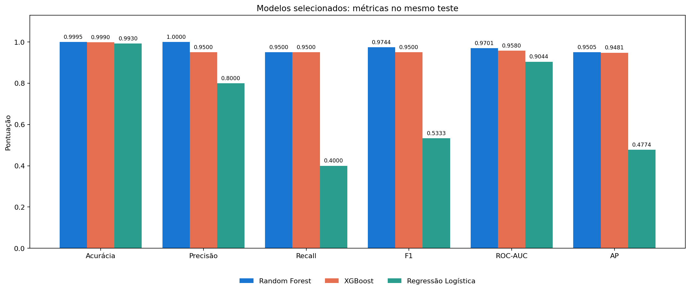
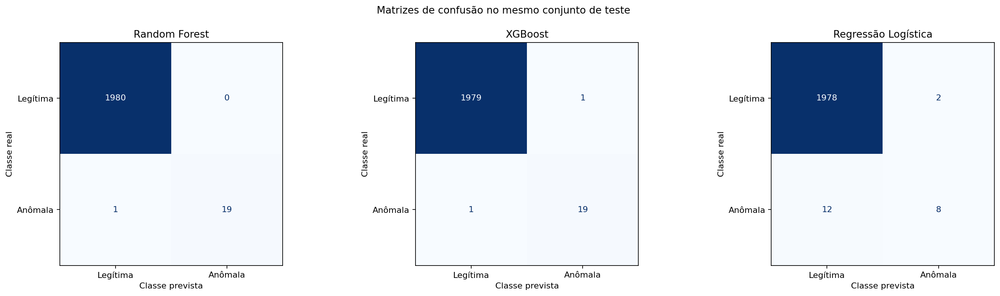
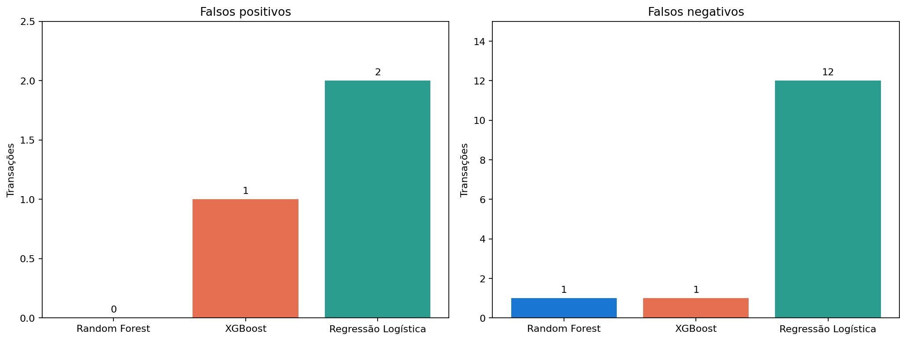
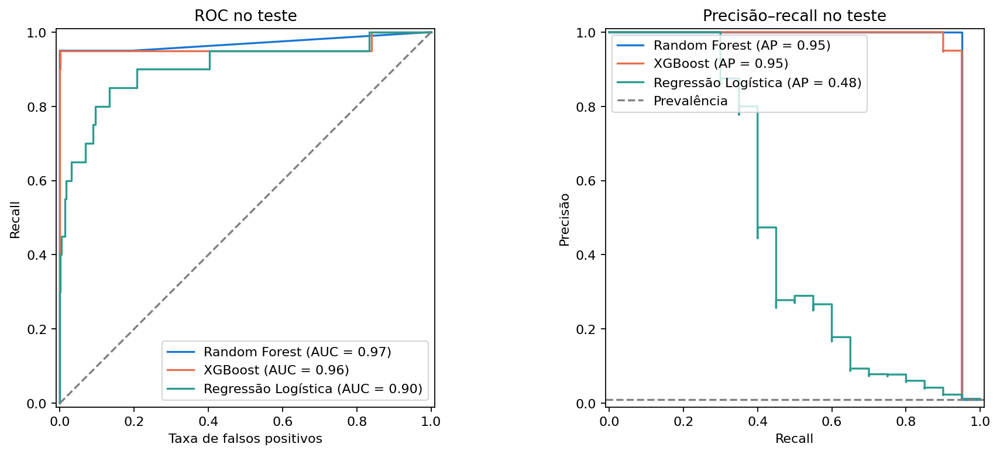
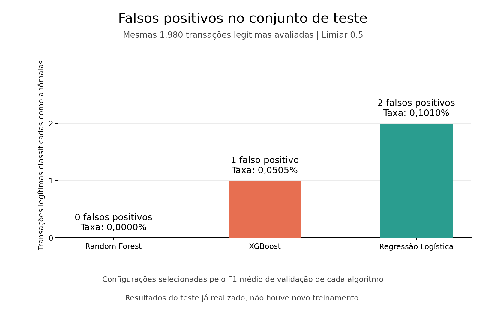
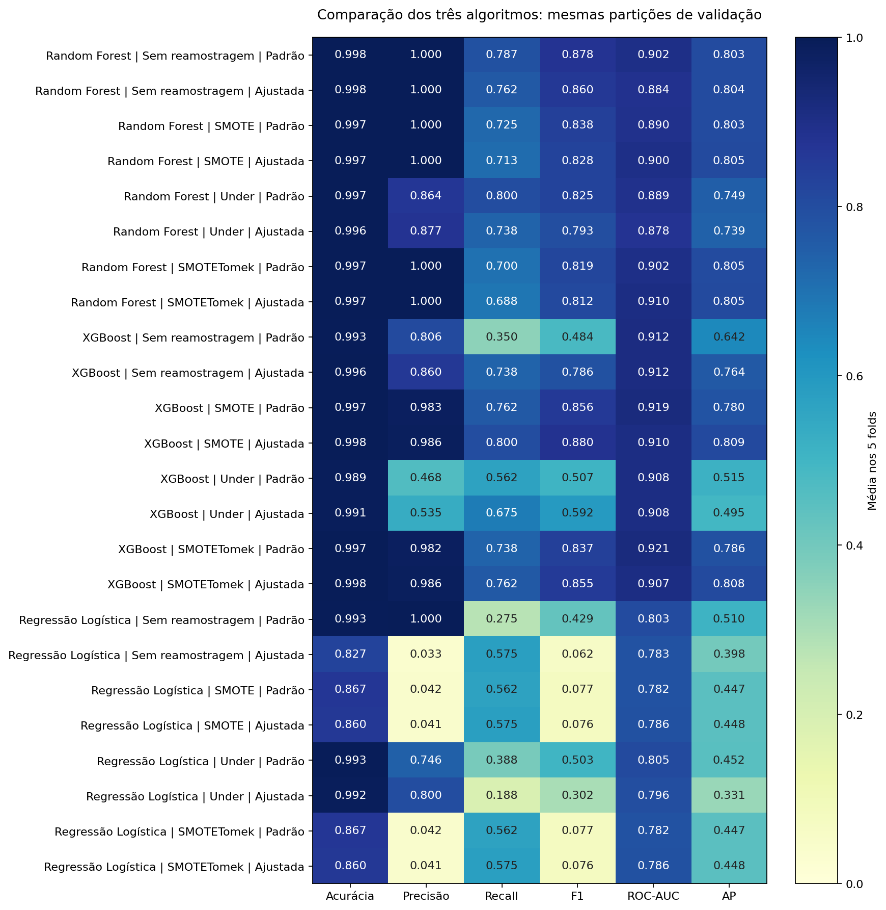

# Índice dos resultados

O experimento compara Random Forest, XGBoost e regressão logística na mesma divisão estratificada: 8.000 transações para treino e 2.000 para teste. São 24 configurações, avaliadas em cinco folds. A seleção de cada algoritmo usa F1 médio de validação, com desempate por AP e ROC-AUC.


## Estrutura da pasta

```text
resultados/
├── README.md
├── dashboard/    # Dashboard interativo offline (index.html)
├── graficos/
│   ├── dados/
│   ├── random_forest/
│   ├── xgboost/
│   ├── logistic_regression/
│   └── comparacao/
├── tabelas/       # Métricas, previsões e importância dos atributos (CSV)
├── modelos/       # Três pipelines treinados (JOBLIB)
├── relatorios/    # Relatório detalhado (Markdown)
├── metadados/     # Configuração e informações do experimento (JSON)
└── historico/     # Arquivos de resultados anteriores preservados
```

## Onde consultar

- [Dashboard interativo com Sankey](dashboard/index.html): visões individuais e comparação dos três algoritmos.

- [Relatório completo](relatorios/RELATORIO.md): procedimento, configurações, métricas e limites de interpretação.
- [Métricas no teste](tabelas/metricas_teste.csv): resultados dos três modelos selecionados.
- [Validação cruzada](tabelas/metricas_validacao_cruzada.csv): todas as configurações, desvios e tempos.
- [Previsões individuais](tabelas/predicoes_teste.csv): probabilidades, classes e índices originais.
- [Metadados](metadados/metadados.json): divisão, distribuição e configurações selecionadas.

## Organização dos gráficos

| Pasta | Conteúdo | Quantidade |
| --- | --- | --- |
| `graficos/dados/` | Distribuição das classes da base | 1 |
| `graficos/random_forest/` | Validação, matriz de confusão, curvas, importância dos atributos e probabilidades | 5 |
| `graficos/xgboost/` | Validação, matriz de confusão, curvas e probabilidades | 4 |
| `graficos/logistic_regression/` | Validação, matriz de confusão, curvas e probabilidades | 4 |
| `graficos/comparacao/` | Comparações de validação, métricas, matrizes, curvas, falsos positivos e erros | 6 |
| `historico/` | Gráfico anterior preservado durante a reorganização | Fora da avaliação atual |

Os pipelines treinados ficam em `modelos/`: `random_forest.joblib`, `xgboost.joblib` e `logistic_regression.joblib`.

## Comparações

### Métricas no teste reservado



### Matrizes de confusão



### Falsos positivos e falsos negativos



### Curvas ROC e precisão–recall



### Falsos positivos



### Todas as configurações na validação



## Gráficos por algoritmo

| Visualização | Random Forest | XGBoost | Regressão logística |
| --- | --- | --- | --- |
| Validação | [Abrir](graficos/random_forest/02_configuracoes_validacao.png) | [Abrir](graficos/xgboost/01_configuracoes_validacao.png) | [Abrir](graficos/logistic_regression/01_configuracoes_validacao.png) |
| Matriz de confusão | [Abrir](graficos/random_forest/03_matriz_confusao.png) | [Abrir](graficos/xgboost/02_matriz_confusao.png) | [Abrir](graficos/logistic_regression/02_matriz_confusao.png) |
| Curvas | [Abrir](graficos/random_forest/04_curvas_roc_precisao_recall.png) | [Abrir](graficos/xgboost/03_curvas_roc_precisao_recall.png) | [Abrir](graficos/logistic_regression/03_curvas_roc_precisao_recall.png) |
| Probabilidades | [Abrir](graficos/random_forest/06_distribuicao_probabilidades.png) | [Abrir](graficos/xgboost/04_distribuicao_probabilidades.png) | [Abrir](graficos/logistic_regression/04_distribuicao_probabilidades.png) |

A importância por redução de impureza está disponível para [Random Forest](graficos/random_forest/05_importancia_atributos.png). Esse gráfico não representa causalidade. A [distribuição das classes](graficos/dados/01_distribuicao_classes.png) descreve a base comum aos três algoritmos.

## Reprodução e conferência

Na raiz do projeto:

```powershell
.\.venv\Scripts\python.exe -m unittest discover -s tests -v
.\.venv\Scripts\python.exe evaluate_models.py
.\.venv\Scripts\python.exe plot_false_positives.py
.\.venv\Scripts\python.exe verify_results.py
```

O verificador recalcula as métricas a partir das previsões, confere a seleção pelo conjunto de validação, carrega os três pipelines e verifica a integridade das 20 imagens atuais. Executar novamente os scripts atualiza os arquivos existentes.


